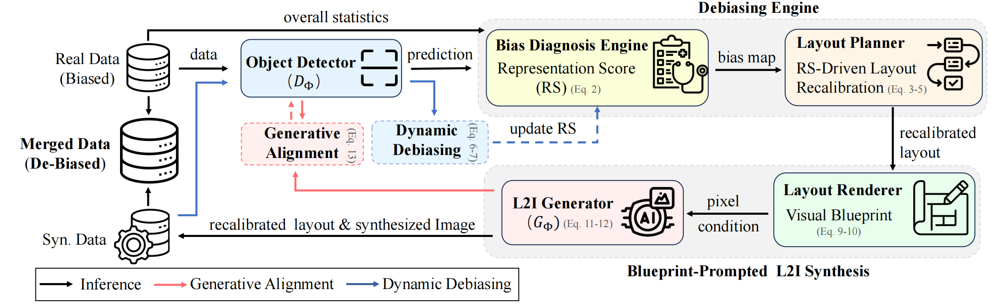

# Unbiased Object Detection Beyond Frequency with Visually Prompted Image Synthesis (ICLR2026)

## Introduction 👋

This repository contains the implementations of **Unbiased Object Detection Beyond Frequency with Visually Prompted Image Synthesis**. The code will made public.



## Abstract 
This paper presents a generation-based debiasing framework for object detection.
Prior debiasing methods are often limited by the representation diversity of samples, while naive generative augmentation often preserves the biases it aims to solve. 
Moreover, our analysis reveals that simply generating more data for rare classes is suboptimal due to two core issues: i) instance frequency is an incomplete proxy for the true data needs of a model, and ii) current layout-to-image synthesis lacks the fidelity and control to generate high-quality, complex scenes.
To overcome this, we introduce the representation score (RS) to diagnose representational gaps beyond mere frequency, guiding the creation of new, unbiased layouts. To ensure high-quality synthesis, we replace ambiguous text prompts with a precise visual blueprint and employ a generative alignment strategy, which fosters communication between the detector and generator.

## Citation 📚

If you find this repository useful, please consider citing:

```bibtex
@inproceedings{cai2026unbiased,
  title={Unbiased Object Detection Beyond Frequency with Visually Prompted Image Synthesis},
  author={Cai, Xinhao and Li, Liulei and Pei, Gensheng and Chen, Tao and Pan, Jinshan and Yao, Yazhou and Wang, Wenguan},
  booktitle=ICLR,
  year={2026}
}
```
